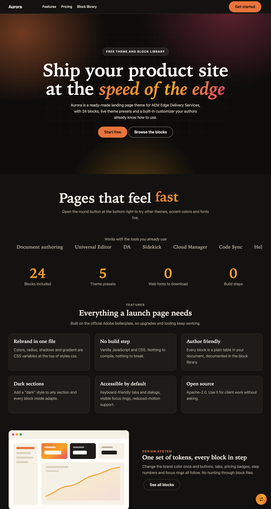

# Aurora — SaaS landing theme for AEM Edge Delivery Services

A free, fast, ready-to-author landing page theme for [AEM Edge Delivery Services](https://www.aem.live/). Built on the official [Adobe AEM boilerplate](https://github.com/adobe/aem-boilerplate), so the standard tooling, Sidekick and upgrade path keep working.

**Live demo:** https://suraj-v23.github.io/aurora-eds-theme/ · **Block library:** https://suraj-v23.github.io/aurora-eds-theme/library/



- No build step, no web fonts, no dependencies at runtime
- Rebrand the whole site from one block of CSS variables
- 32 blocks, 7 theme presets, 5 font styles and a live theme customizer panel, each authored as a plain table
- Interactive components (tabs, carousel, accordion, modal, embed) in plain JavaScript
- A live block library page that documents every block
- Dark by default with a warm orange accent, scroll animations, visible focus rings, reduced-motion support

## Quick start

1. Click **Use this template** on GitHub to create your own repository.
2. Install the [AEM Code Sync](https://github.com/apps/aem-code-sync) GitHub app on it.
3. Point the project at your content source (Google Drive, SharePoint or DA) as described in the [AEM developer tutorial](https://www.aem.live/developer/tutorial).
4. Run it locally with the bundled demo page:

```sh
npm install
npm run dev
```

Open http://localhost:3000. The demo content lives in [`drafts/`](drafts/). In the local demo, section styles are written as classes on the section `<div>`; on a real site authors use the Section Metadata table and the delivery service adds those classes.

## Rebrand

Edit the variables at the top of [`styles/styles.css`](styles/styles.css):

| Variable | Controls |
|---|---|
| `--link-color`, `--link-hover-color` | Brand color: buttons, links, highlights |
| `--background-color`, `--surface-color`, `--light-color` | Page, raised card and alt section backgrounds |
| `--on-accent` | Text color on accent-filled buttons |
| `--accent-color` | Check marks, focus ring |
| `--gradient` | Stat numbers, step numbers, badges, call-to-action band |
| `--accent-2`, `--accent-3` | Gradient stops after the accent |
| `--night-color` | Hero, footer and dark section background |
| `--radius`, `--shadow` | Card shape and depth |
| `--body-font-family`, `--heading-font-family` | Fonts (system stack by default) |

## Blocks

Each block is a table in your document. The first row is the block name. See every block live, with authoring notes, on the **block library page**: run `npm run dev` and open http://localhost:3000/library ([source](drafts/library.html)).

**Layout and content**

| Block | Rows | Columns |
|---|---|---|
| **Hero** | One row | Heading, text, buttons. Italic words in the heading get the gradient. An italic line above the heading becomes a pill label. Optional image becomes the background. |
| **Cards** | One per card | Optional image column, then heading and text |
| **Columns** | One per feature | Image cell and text cell. Rows alternate sides on desktop. |
| **Stats** | One per stat | Number, label. Numbers count up on scroll. |
| **Steps** | One per step | Title, description. Numbered automatically. |
| **Logos** | Any | One logo image or company name per cell |
| **Testimonials** | One per quote | Quote, then name and role |
| **Pricing** | One per plan | Plan name (H3), price, feature list, button. Optional second column with badge text such as "Most popular" highlights the plan. |
| **Table** | First row is the heading row | One cell per column |
| **Callout** | One | Content. Variants: `Callout (success)`, `Callout (warning)` |

**Interactive components** (plain JavaScript, loaded only on pages that use them)

| Block | Rows | Columns |
|---|---|---|
| **Tabs** | One per tab | Tab label, panel content. Arrow-key navigation. |
| **Accordion** | One per item | Question, answer |
| **Carousel** | One per slide | Optional image column, then content. Scroll-snap, arrow buttons, no autoplay. |
| **Modal** | One | Button label, dialog content. Native `<dialog>`. |
| **Embed** | One | YouTube or Vimeo link. Loads the player only after the visitor presses play. |

**New in the redesign**

| Block | Rows | Columns |
|---|---|---|
| **Breadcrumb** | Empty, or links | Empty builds Home / path from the URL. Page metadata `breadcrumb` = `on` adds it to the top automatically. |
| **Marquee** | One row, any cells | Text or logos looping sideways. Pauses on hover. Variant: `Marquee (reverse)`. |
| **Timeline** | One per event | Date, then heading and text. Alternates sides on desktop. |
| **Sidebar** | One | Cell 1: nav links (bold-only paragraph or heading + list = group; sticky, highlights current; collapses to a Menu button on mobile). Cell 2: content. Variants: `docs` (760px column), `toc` (adds "On this page"). |
| **Animated Text** | Two | Row 1: text before. Row 2: list of words to cycle. |
| **Feature Grid** | One per tile | Optional icon line, heading, text. First tile is larger. Variants: `wide`, `uniform`. |

**Media, data and developer blocks**

| Block | Rows | Columns |
|---|---|---|
| **Gallery** | Any | One image per cell; click opens a lightbox (alt text = caption) |
| **Image Compare** | One | Before image, after image. Slider works with mouse, touch and arrow keys. |
| **Hotspot** | Row 1 image, then one per pin | x %, y %, popover content |
| **Video** | One | mp4, YouTube or Vimeo link, optional poster image. Player loads on click. |
| **Page List** | Config rows, or links | `filter`, `limit`, `search` rows. Cards come from `/query-index.json`, falling back to the authored links. |
| **Form** | One per field | Label, type (`text`, `email`, `textarea`, `select`, `checkbox`), required, options. Last row: `submit`, label, endpoint (JSON POST; no endpoint = demo message). |
| **Countdown** | One | Target date/time, label, optional finished text |
| **Admin API** | Optional config rows | `org`, `site`, `ref`, `path`. Builds an Admin API curl command with a `$AEM_TOKEN` placeholder; never calls the API. |

**From the boilerplate:** Fragment, Header, Footer. Fragment, Header, Footer.

Buttons: make a link **bold** for a primary button, *italic* for a secondary button.

Eyebrow labels: an italic-only line directly above any heading becomes a small uppercase label.

## Site search and developer page

- **Header search:** the header has a search button (also Ctrl/Cmd+K or `/`) that opens a dialog with live results. It reads `/query-index.json`; without one it crawls the pages linked from the nav and sidebar fragments. Code: [`blocks/header/search.js`](blocks/header/search.js). `tools/build-demo.sh` generates a query index for the demo.
- **Developer page:** [`drafts/developer.html`](drafts/developer.html) (`/developer`) hosts the Admin API block plus a cheat sheet and token safety notes.

## Section styles

Add a **Section Metadata** table with a `Style` row. Combine with commas, for example `dark, center`.

| Style | Effect |
|---|---|
| `center` | Centered text, narrower intro paragraph |
| `narrow` | 800px content width, good for FAQ and long text |
| `light` | Soft grey band |
| `dark` | Dark band; every block inside adapts |
| `cta` | Gradient call-to-action band |
| `fade-up`, `zoom`, `slide-left`, `slide-right`, `stagger` | Scroll animation (fade-up is the default; stagger animates the items inside blocks in sequence) |

## Themes and customizer

- **Presets:** set `data-theme` on `<html>` to `ember` (default), `light`, `midnight`, `forest`, `mono`, `docs` (calm documentation look) or `docs-dark`. Each preset only overrides CSS variables.
- **Fonts:** `data-font` = `classic`, `modern`, `mono`, `rounded` or `editorial`. System stacks only.
- **Motion:** `data-motion="off"` disables all animation (reduced-motion users get this automatically).
- **Customizer panel:** a "Customize" button at the bottom right ([`scripts/theme-panel.js`](scripts/theme-panel.js)) lets visitors pick preset, accent color, font and motion. Choices are saved in `localStorage`. Disable it on a page with page metadata `theme-panel` = `off`.
- **Docs template:** set page metadata `template` = `docs`, `sidebar` = path of a nav fragment (for example `/drafts/docs-nav`: bold-only paragraphs as group labels, each followed by a list of links) and optionally `theme` = `docs`. The page gets a left navigation, a 760px content column and an "On this page" outline from its h2/h3. `theme` sets the default preset for visitors who have not chosen one. See `drafts/docs.html`.
- **Default theme:** edit the `:root` tokens in `styles/styles.css` (they are the ember theme).

## Development

```sh
npm run lint
```

## Demo site

The live demo is a static copy of `drafts/`, built by `tools/build-demo.sh` and deployed to GitHub Pages on every push to `main`. It shows the theme; a real project is served by AEM Edge Delivery from your own content source.

## License

Apache-2.0. Based on the Adobe AEM boilerplate, © Adobe, also Apache-2.0. See [LICENSE](LICENSE).
